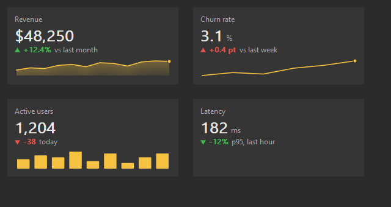
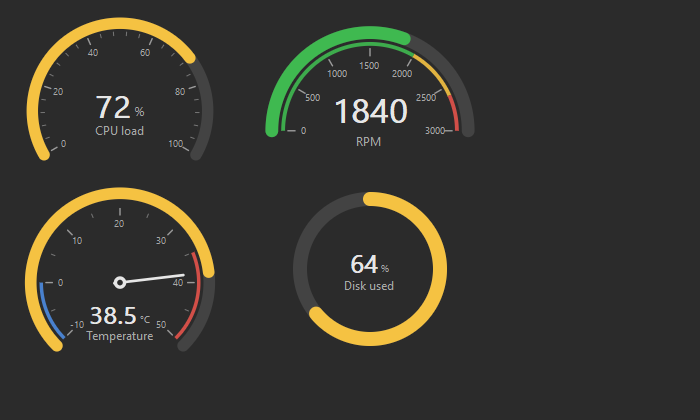
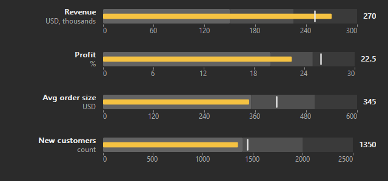
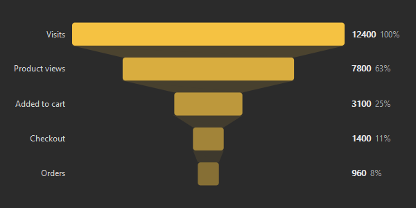
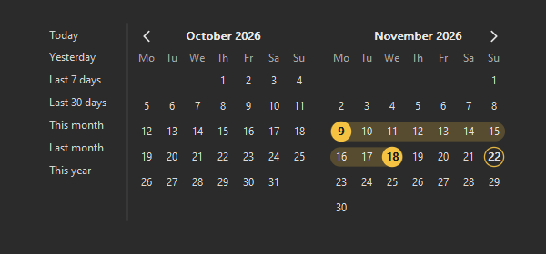
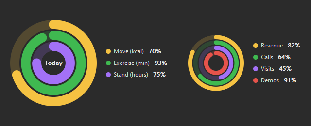
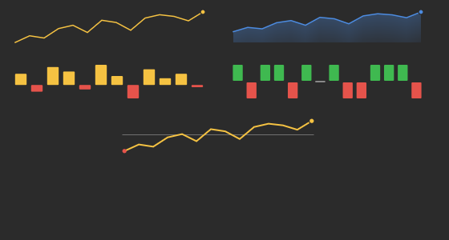
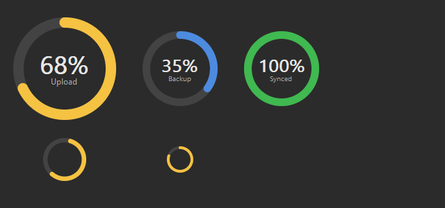
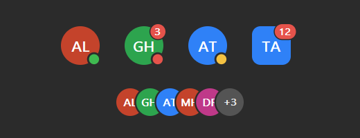
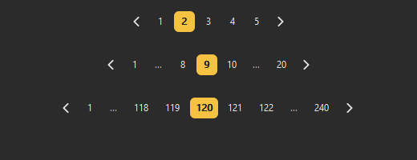

# tkribbon demo

Try **tkribbon**, an Office-style ribbon, docking panes and 60+ custom-drawn widgets for Tcl/Tk, written in C. It
runs on **Windows** and **Linux** (X11), in **Tcl/Tk 8.5, 8.6 and 9.0**, and in Python's tkinter. This repository holds the demo
programs only; they need nothing installed, not even Tcl/Tk.


## New in 0.2.0

Widgets for dashboards, drawn smoothly and following the dark and light themes (see the
[screenshots](#dashboard-widgets) below):

- `rtk::gauge`: round meters with colored zones, ticks and an optional needle
- `rtk::progressring` and `rtk::activityrings`: a round progress indicator, and several rings for several goals
- `rtk::sparkline` and `rtk::kpi`: word-sized charts, and key figure tiles with the change and a sparkline
- `rtk::bulletchart` and `rtk::funnelchart`: a measure against its target, and the stages of a funnel
- `rtk::daterange`: a date range picker with presets and two months
- `rtk::avatar` and `rtk::pagination`: people with status dots and badges, and a page bar for long lists
- cell types for `rtk::datagrid`: progress bars, sparklines, check boxes, status badges and star ratings in columns

All of them are in Python too. Three new examples show them: **meters** (a server monitor), **sales** (a sales
dashboard) and **team** (a team page). Each version now has its own 15 days of trial.

## About this release

tkribbon is planned as a commercial product. Before deciding on licensing and pricing, I am releasing these demo
programs to see whether the library is useful to Tcl/Tk developers and what they would need from it. That is why the
programs are time-limited and the source is not public yet.

Your feedback helps decide what comes next: which widgets you would use, what is missing, which platforms or Tcl/Tk
versions matter to you, and what kind of license would work for you (per developer, per project, source included,
and so on). Please share it in the [Issues](https://github.com/hanulso78/tkribbon-demo/issues).

## Download

Get the files from the [Releases](https://github.com/hanulso78/tkribbon-demo/releases) page. Each platform has the
same two programs:

- **tkribbon-demo**: one window with a ribbon, docking panes, a code editor, widgets, a data grid with 20,000 rows,
  charts, a setup wizard, and every example in tabs.
- **tkribbon-examples**: the examples launcher, with 109 small programs, one per widget or topic, grouped by topic
  with a filter box. Double-click one to run it in its own window.

| Platform | File | Notes |
|---|---|---|
| Windows | `tkribbon-demo.exe`, `tkribbon-examples.exe` | Windows 10 or 11, 64-bit; runs on Tcl/Tk 8.5 |
| Windows | `tkribbon-demo-tcl9.exe`, `tkribbon-examples-tcl9.exe` | The same programs on Tcl/Tk 9.0 |
| Linux | `tkribbon-demo-linux-x86_64.tar.gz` | Both programs in one archive; x86-64 with glibc 2.28 or newer; runs on Tcl/Tk 9.0 |
| Python | `tkribbon-0.2.0-py3-none-win_amd64.whl`, `tkribbon-0.2.0-py3-none-manylinux_2_28_x86_64.whl` | The library for tkinter, Python 3.8 or newer: `pip install <file>` |

All the files are time-limited: they work for **15 days** from the first start on a computer. Each version has its
own 15 days.

### Windows

- The programs are not signed, so Windows SmartScreen may ask before starting them ("More info", then "Run anyway").
- On the first start a program unpacks its files into `%LOCALAPPDATA%\tkribbon-demo` (or `tkribbon-examples`).
  To remove them, delete those folders.

### Linux

```sh
tar -xzf tkribbon-demo-linux-x86_64.tar.gz
cd tkribbon-demo-linux-x86_64
./tkribbon-demo
./tkribbon-examples
```

- Built and tested on AlmaLinux 8; it should run on any x86-64 distribution with glibc 2.28 or newer (RHEL/Rocky 8+,
  Fedora, Debian 10+, Ubuntu 20.04+, and so on). Each program holds its own Tcl/Tk 9, so only the usual desktop libraries are needed: X11, Xft, fontconfig
  and freetype.
- It runs on X11 desktops and on Wayland desktops through XWayland.
- On the first start a program unpacks its files into `~/.cache/tkribbon-demo` (or `tkribbon-examples`); the trial
  record is kept in `~/.config/tkribbon`. To remove them, delete those folders.

## What is in tkribbon

| Package | What it adds |
|---|---|
| `tkribbon` | Ribbon (tabs, groups, galleries, quick access toolbar, key tips, contextual tabs, backstage), drawn title bar and frameless windows, docking panes (tabify, split, float, auto-hide), dockable toolbars, menu bar and drawn menus, themes with DPI scaling, and widgets: buttons, line and masked edits, auto-completion, date and time edits, sliders, dials, ratings, color and font pickers, tree list, data grid, property grid, pivot table, spreadsheet, calendar scheduler, Gantt timeline, Kanban board, node editor, diagram editor, photo editor, hex editor, rich text editor, Markdown viewer, terminal, chat view, map view, QR codes and bar codes, web view (WebView2 on Windows), task, input and progress dialogs, notification area (tray) icons, drag and drop, JSON and XML, saving and restoring the window arrangement; for dashboards: gauges, progress and activity rings, sparklines, key figure tiles, bullet and funnel charts, a date range picker, avatars, a page bar, and data grid cells drawn as bars, sparklines, check boxes, badges and stars |
| `tkscintilla` | Scintilla code editor with ruler, minimap, find bar, diff view, code outline and autocomplete |
| `tkgraph` | Graphs and charts: lines, bars, pie, heatmap, polar, 3D surfaces, figures with several plots, export |
| `tkhtmlview` | HTML/CSS viewer: flex, grid, CSS variables, gradients, history, find, zoom, forms |

### Tcl/Tk versions

tkribbon supports both Tcl/Tk 8.x and 9.x. Each library comes in two builds, and `package require` loads the one
that matches the running Tcl:

| | Tcl/Tk 8.5 and 8.6 | Tcl/Tk 9.0 |
|---|---|---|
| Windows | `tkribbon.dll`, `tkscintilla.dll`, `tkgraph.dll`, `tkhtmlview.dll` | `tcl9tkribbon.dll`, `tcl9tkscintilla.dll`, `tcl9tkgraph.dll`, `tcl9tkhtmlview.dll` |
| Linux | `tkribbon.so`, `tkscintilla.so`, `tkgraph.so`, `tkhtmlview.so` | `tcl9tkribbon.so`, `tcl9tkscintilla.so`, `tcl9tkgraph.so`, `tcl9tkhtmlview.so` |
| Demo programs | `tkribbon-demo.exe`, `tkribbon-examples.exe` (Windows, Tcl/Tk 8.5) | `tkribbon-demo-tcl9.exe`, `tkribbon-examples-tcl9.exe` (Windows), `tkribbon-demo`, `tkribbon-examples` (Linux) |
| Python wheels | Used when tkinter runs on Tk 8.6 | Used when tkinter runs on Tk 9 |

The libraries use the stubs interfaces, so the 8.x build loads in any Tcl/Tk from 8.5 on and the 9.x build in any
Tcl/Tk 9.0. The examples are tested on Tcl/Tk 8.6 and 9.0, and the same scripts run on both.

### Commands

All commands live in the `rtk::` namespace:

```tcl
package require tkribbon

::rtk::theme darkgray
rtk::ribbon .r
.r tab add home -text Home
.r group add home g -text Greeting
.r item add g hello -text "Say hello" -command {puts "Hello, world!"}
pack .r -fill x
```

The same widgets are classes in Python:

```python
import tkinter as tk
import tkribbon as rtk

root = tk.Tk()
rtk.theme("darkgray")
ribbon = rtk.Ribbon(root)
ribbon.tab.add("home", text="Home")
ribbon.group.add("home", "greeting", text="Greeting")
ribbon.item.add("greeting", "hello", text="Say hello", command=lambda: print("Hello, world!"))
ribbon.pack(fill="x")
root.mainloop()
```

## Screenshots

The same demo on Windows 10 and on Linux (AlmaLinux 8, Tcl/Tk 9).

### Windows

**Code editor** (tkscintilla) with the ruler, minimap and margin tips


**Dashboard example**: navigation view, tile dashboard, seven-segment clock, LEDs, ratings


**Graphs** (tkgraph): smooth lines with area fill, steps, zoom and crosshairs


**Data grid** with 20,000 rows, grouping and filters


**Widgets** in the light theme


**Examples launcher** (`tkribbon-examples.exe`)


### Linux

**Start page**


**Code editor** (tkscintilla)


**Dashboard example**


**Graphs** (tkgraph)


**Data grid**


**Widgets** in the light theme


**Examples launcher** (`tkribbon-examples`)


### Dashboard widgets

New in 0.2.0, on Windows in the darkgray theme.

| | |
|---|---|
| Key figure tiles (`rtk::kpi`)<br> | Gauges (`rtk::gauge`)<br> |
| Bullet charts (`rtk::bulletchart`)<br> | Funnel chart (`rtk::funnelchart`)<br> |
| Date range picker (`rtk::daterange`)<br> | Activity rings (`rtk::activityrings`)<br> |
| Sparklines (`rtk::sparkline`)<br> | Progress rings (`rtk::progressring`)<br> |
| Avatars (`rtk::avatar`)<br> | Page bars (`rtk::pagination`)<br> |

## Feedback

Questions, comments and bug reports are welcome in the [Issues](https://github.com/hanulso78/tkribbon-demo/issues).
